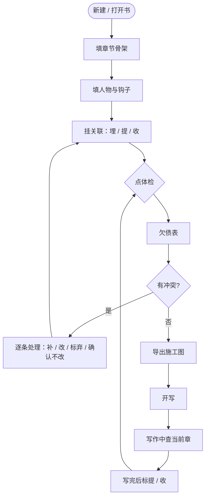
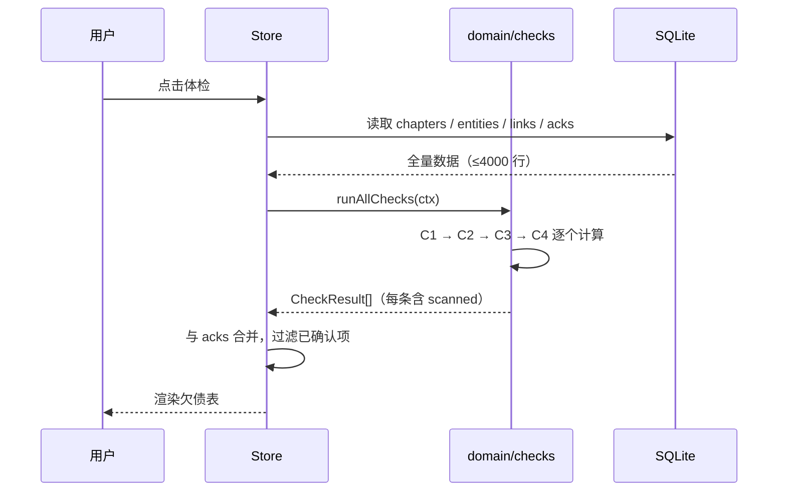
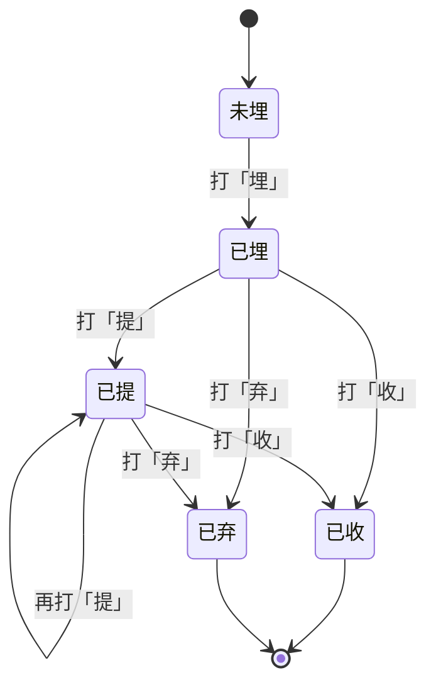
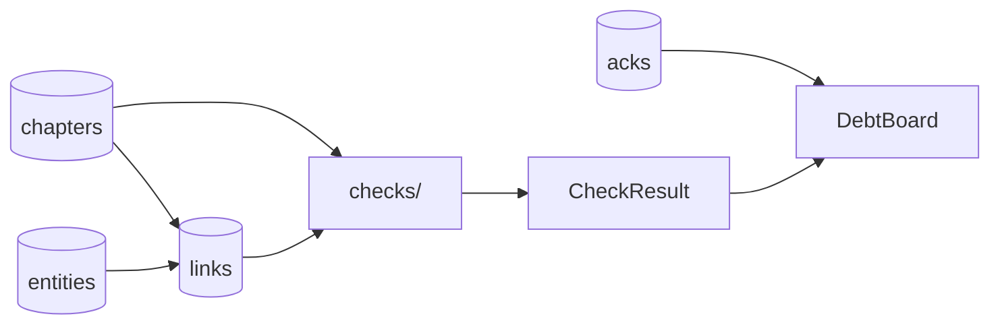

# 开发文档：小说前期规划工具

| 项目 | 内容 |
|---|---|
| 文档名称 | 小说前期规划工具 · 技术设计与开发文档 |
| 版本 | v2.0（完整版，替代 v1.0） |
| 日期 | 2026-10-19 |
| 对应需求 | `PRD_小说规划工具.md` v2.0 |
| 目标平台 | Windows 10+ |

---

## 目录

1. 技术选型
2. 系统架构
3. 数据设计
4. 核心模块设计
5. 检查算法
6. 三态与双轨值的实现
7. 界面实现要点
8. 导出模块
9. 错误处理与日志
10. 测试方案
11. 构建与发布
12. 开发计划
13. 风险与对策
14. 附录

---

# 1. 技术选型

## 1.1 运行形态

**本地单机桌面应用，数据存本地单文件，无服务端。**

这个决定来自三条需求约束：

| 约束 | 推导 |
|---|---|
| 不碰正文 | 不需要富文本引擎，不需要版本控制 |
| 数据安全（PRD 7.2） | 本地文件最可信，用户可自行复制 |
| 单人开发 | 无服务端，就没有运维、没有账号、没有备案 |

## 1.2 技术栈

| 层 | 选型 | 版本 | 说明 |
|---|---|---|---|
| 应用外壳 | Tauri | 2.x | 包体 5–10MB，系统 WebView 渲染 |
| 前端框架 | React | 18.x | 组件化，生态成熟 |
| 语言 | TypeScript | 5.x | 类型安全，字段多，必须有类型 |
| 构建 | Vite | 5.x | 快 |
| 数据库 | SQLite | 3.45+ | 单文件，零配置 |
| DB 驱动 | `@tauri-apps/plugin-sql` | 2.x | Tauri 官方 SQL 插件（内部 sqlx） |
| 虚拟滚动 | `@tanstack/react-virtual` | 3.x | 章节表 / 钩子表 |
| 状态 | Zustand | 4.x | 轻量，不用 Redux |
| 路由 | 不用 | — | 单窗口，用状态切换视图即可 |
| 样式 | 原生 CSS + CSS 变量 | — | 不引 UI 库，界面要克制 |
| 测试 | Vitest | 1.x | 单测检查逻辑 |

## 1.3 替代方案与切换条件

| 方案 | 何时切换 | 代价 |
|---|---|---|
| Electron + better-sqlite3 | Rust 工具链装不上，或 Tauri 打包卡住超过 2 天 | 包体 100MB+，内存占用高 |
| 纯浏览器 + IndexedDB | 只打算自己用，且不想装任何环境 | 数据在浏览器里，用户不放心；导出依赖手动 |

**判断标准：如果 Tauri 环境在半天内跑不起来 hello world，立刻换 Electron。**

## 1.4 开发环境

```
Node.js  ≥ 20
Rust     ≥ 1.77（stable）
Tauri CLI  2.x
Windows  WebView2 Runtime（Win10 需单独安装）
```

---

# 2. 系统架构

## 2.1 分层

```
┌─────────────────────────────────────┐
│  UI 层（React 组件）                  │
│  章节表 / 人物 / 钩子 / 欠债表 / 当前章  │
└──────────────┬──────────────────────┘
               │ 调用
┌──────────────▼──────────────────────┐
│  应用层（hooks + store）              │
│  加载数据、触发检查、处理编辑           │
└──────────────┬──────────────────────┘
               │
    ┌──────────┴──────────┐
    ▼                     ▼
┌────────────┐    ┌──────────────────┐
│ domain/    │    │ db/repo          │
│ checks     │    │ 增删改查 + 事务    │
│ 纯函数      │    └────────┬─────────┘
└────────────┘             ▼
                    ┌──────────────┐
                    │ SQLite 文件   │
                    └──────────────┘
```

**硬性约束**：`domain/` 不允许 import 任何 UI 或 db 代码。它只接受普通对象，返回普通对象。

## 2.2 目录结构

```
src-tauri/                  Rust 侧（几乎不动）
  src/main.rs
  tauri.conf.json

src/
├── main.tsx
├── App.tsx
├── db/
│   ├── schema.sql          建表 DDL
│   ├── migrate.ts          版本迁移
│   └── repo.ts             数据访问
├── domain/
│   ├── types.ts            Chapter / Entity / Link / Issue
│   ├── checks/
│   │   ├── types.ts        CheckContext / CheckResult
│   │   ├── c1-unpaid.ts
│   │   ├── c2-groundless.ts
│   │   ├── c3-interval.ts
│   │   ├── c4-stale.ts
│   │   └── index.ts        runAllChecks()
│   └── stats.ts            未标注章节统计等
├── store/
│   └── useBookStore.ts     Zustand
├── ui/
│   ├── views/
│   │   ├── ChapterTable.tsx
│   │   ├── EntityList.tsx
│   │   ├── EntityDetail.tsx
│   │   ├── DebtBoard.tsx
│   │   ├── CurrentChapter.tsx
│   │   └── Settings.tsx
│   └── components/
│       ├── StatusDot.tsx   三态圆点
│       ├── LinkEditor.tsx  埋提收编辑器
│       └── EmptyState.tsx  空态（D1 约束）
├── export/
│   └── markdown.ts
└── styles/
    └── tokens.css
```

## 2.3 数据流

```
启动
  → 打开 SQLite
  → 全量加载 chapters / entities / links 到内存 store
  → 渲染章节表
  → 用户点"体检"
      → runAllChecks({ chapters, entities, links, thresholds })
      → 返回 CheckResult[]（含 scanned）
      → 与 acks（已确认项）合并
      → 渲染欠债表
  → 用户编辑
      → 写库（事务）
      → 更新内存 store
      → 标脏，下次打开欠债表重算
```

**为什么全量加载到内存：**

| 数据量 | 现状 |
|---|---|
| 章节 | ≤ 500 行 |
| 实体 | ≤ 500 行 |
| 关联 | ≤ 3000 行 |

总计不到 4000 行，JSON 序列化后 1MB 以内。**全量加载 + JS 计算，比写复杂 SQL 更简单、更快、更好测。**

这也是本方案与"用 SQL 聚合算检查"的取舍：V0.1 不用 SQL 做计算，SQL 只负责存取。

---

## 2.4 核心流程图

### 2.4.1 用户主流程



### 2.4.2 检查执行时序



### 2.4.3 钩子状态机



**「已埋」「已提」两态即为欠债中**，是 C1 与 C3 的检查对象。

### 2.4.4 数据流



**所有检查都发生在 `links` 上**——这是只需要一张关联表的根本原因。

---

# 3. 数据设计

## 3.1 实体关系

```
books 1 ──── n chapters
  │               │
  │               │
  └── 1 ──── n entities
                  │
                  │ n
                  │
                links ── n ── chapters
                  
acks      （检查结果的"已确认"标记，独立表）
revisions （双轨值历史，P1）
```

## 3.2 完整 DDL

```sql
PRAGMA journal_mode = WAL;
PRAGMA foreign_keys = ON;

-- 书
CREATE TABLE IF NOT EXISTS books (
  id              TEXT    PRIMARY KEY,
  title           TEXT    NOT NULL,
  genre           TEXT    DEFAULT '',
  target_words    INTEGER DEFAULT 0,
  last_chapter_id TEXT,
  created_at      INTEGER NOT NULL,
  updated_at      INTEGER NOT NULL
);

-- 章节（横轴）
CREATE TABLE IF NOT EXISTS chapters (
  id          TEXT    PRIMARY KEY,
  book_id     TEXT    NOT NULL REFERENCES books(id) ON DELETE CASCADE,
  no          INTEGER NOT NULL,
  title       TEXT    DEFAULT '',
  summary     TEXT    DEFAULT '',
  change      TEXT    DEFAULT '',
  time_label  TEXT    DEFAULT '',
  status      TEXT    NOT NULL DEFAULT 'todo'
                      CHECK (status IN ('todo','writing','done')),
  UNIQUE (book_id, no)
);

-- 实体（统一表）
CREATE TABLE IF NOT EXISTS entities (
  id         TEXT PRIMARY KEY,
  book_id    TEXT NOT NULL REFERENCES books(id) ON DELETE CASCADE,
  type       TEXT NOT NULL
             CHECK (type IN ('character','hook','prop','thread')),
  code       TEXT DEFAULT '',
  name       TEXT NOT NULL,
  layer      TEXT DEFAULT ''
             CHECK (layer IN ('','core','major','func','extra')),
  data       TEXT NOT NULL DEFAULT '{}',
  planned    TEXT,                     -- 双轨值：原计划快照（JSON）
  created_at INTEGER NOT NULL,
  updated_at INTEGER NOT NULL
);

-- 关联（唯一真值来源）
CREATE TABLE IF NOT EXISTS links (
  id         TEXT PRIMARY KEY,
  entity_id  TEXT NOT NULL REFERENCES entities(id) ON DELETE CASCADE,
  chapter_id TEXT NOT NULL REFERENCES chapters(id) ON DELETE CASCADE,
  role       TEXT NOT NULL
             CHECK (role IN ('plant','hint','pay','drop','appear','hold')),
  note       TEXT DEFAULT '',
  created_at INTEGER NOT NULL,
  UNIQUE (entity_id, chapter_id, role)     -- 同一实体同一章同一角色只记一次
);

-- 已确认（三态里的第二态）
CREATE TABLE IF NOT EXISTS acks (
  id         TEXT PRIMARY KEY,
  entity_id  TEXT NOT NULL REFERENCES entities(id) ON DELETE CASCADE,
  check_id   TEXT NOT NULL,           -- C1/C2/C3/C4
  reason     TEXT DEFAULT '',
  created_at INTEGER NOT NULL,
  UNIQUE (entity_id, check_id)
);

-- 变更历史（P1）
CREATE TABLE IF NOT EXISTS revisions (
  id         TEXT PRIMARY KEY,
  entity_id  TEXT NOT NULL,
  field      TEXT NOT NULL,
  old_value  TEXT,
  new_value  TEXT,
  created_at INTEGER NOT NULL
);

-- 设置（键值）
CREATE TABLE IF NOT EXISTS settings (
  key   TEXT PRIMARY KEY,
  value TEXT NOT NULL
);
```

## 3.3 索引

```sql
CREATE INDEX IF NOT EXISTS idx_links_entity   ON links(entity_id, role);
CREATE INDEX IF NOT EXISTS idx_links_chapter  ON links(chapter_id);
CREATE INDEX IF NOT EXISTS idx_entities_book  ON entities(book_id, type);
CREATE INDEX IF NOT EXISTS idx_chapters_book  ON chapters(book_id, no);
CREATE INDEX IF NOT EXISTS idx_acks_entity    ON acks(entity_id, check_id);
```

## 3.4 数据迁移

用 `PRAGMA user_version` 记录 schema 版本。

```ts
const MIGRATIONS: Record<number, string[]> = {
  0: [ /* v1 schema，见 3.2 */ ],
  1: [ /* 未来：加字段 */ ]
};

export async function migrate(db: Database) {
  const { user_version: v } = await db.get('PRAGMA user_version');
  for (let i = v; i < CURRENT_VERSION; i++) {
    for (const sql of MIGRATIONS[i] ?? []) await db.execute(sql);
    await db.execute(`PRAGMA user_version = ${i + 1}`);
  }
}
```

**规则：任何 schema 变更都必须新增一条迁移，不允许手改线上库。**

## 3.5 备份与恢复

| 项 | 策略 |
|---|---|
| 触发 | 每天首次启动 |
| 位置 | `<数据目录>/backup/YYYYMMDD.db` |
| 保留 | 最近 30 份，超出按日期删最旧 |
| 实现 | SQLite `VACUUM INTO`（原子复制，不锁表） |
| 恢复 | 设置页列出备份 → 选择 → 校验可读 → 关闭当前库 → 替换 → 重启 |

**恢复前必须把当前库另存为 `pre-restore.db`，防误操作。**

---

# 4. 核心模块设计

## 4.1 类型定义

```ts
// domain/types.ts
export type Role = 'plant' | 'hint' | 'pay' | 'drop' | 'appear' | 'hold';
export type EntityType = 'character' | 'hook' | 'prop' | 'thread';
export type EntityLayer = '' | 'core' | 'major' | 'func' | 'extra';

export interface Chapter {
  id: string;
  bookId: string;
  no: number;
  title: string;
  summary: string;
  change: string;
  timeLabel: string;
  status: 'todo' | 'writing' | 'done';
}

export interface Entity {
  id: string;
  bookId: string;
  type: EntityType;
  code: string;
  name: string;
  layer: EntityLayer;
  data: Record<string, unknown>;
  planned?: Record<string, unknown> | null;
}

export interface Link {
  id: string;
  entityId: string;
  chapterId: string;
  role: Role;
  note: string;
}

export interface Ack {
  entityId: string;
  checkId: string;
  reason: string;
}
```

## 4.2 检查模块接口

```ts
// domain/checks/types.ts
export interface CheckContext {
  chapters: Chapter[];
  entities: Entity[];
  links: Link[];
  acks: Ack[];
  /** 已被作者确认不改的，不再输出 */
  maxChapterNo: number;
  thresholds: {
    c3Interval: number;   // 默认 15
    c4Stale: number;      // 默认 10
  };
}

export interface Issue {
  entityId: string;
  entityName: string;
  checkId: 'C1' | 'C2' | 'C3' | 'C4';
  reason: string;
  chapters: number[];
  severity: 'high' | 'mid';
}

export interface CheckResult {
  checkId: 'C1' | 'C2' | 'C3' | 'C4';
  issues: Issue[];
  /** 参与本次计算的记录数。必须返回。 */
  scanned: number;
  /** 该检查是否启用 */
  enabled: boolean;
}
```

## 4.3 汇总执行

```ts
// domain/checks/index.ts
export function runAllChecks(ctx: CheckContext): CheckResult[] {
  return [checkC1(ctx), checkC2(ctx), checkC3(ctx), checkC4(ctx)];
}

/** 未标注章节：没有任何 link 的章节 */
export function findUnmarkedChapters(ctx: CheckContext): Chapter[] {
  const marked = new Set(ctx.links.map(l => l.chapterId));
  return ctx.chapters.filter(c => !marked.has(c.id));
}
```

---

# 5. 检查算法

## 5.1 C1 埋了没收

```ts
export function checkC1(ctx: CheckContext): CheckResult {
  const issues: Issue[] = [];
  let scanned = 0;

  for (const e of ctx.entities) {
    if (e.type !== 'hook' && e.type !== 'prop') continue;

    const rels = ctx.links.filter(l => l.entityId === e.id);
    const plant = rels.find(r => r.role === 'plant');
    if (!plant) continue;                      // 没埋过，不归 C1 管

    scanned++;

    const hasPay = rels.some(r => r.role === 'pay');
    const hasDrop = rels.some(r => r.role === 'drop');
    if (hasPay || hasDrop) continue;

    // 已被作者确认不改
    if (ctx.acks.some(a => a.entityId === e.id && a.checkId === 'C1')) continue;

    const plantNo = chapterNo(ctx, plant.chapterId);
    issues.push({
      entityId: e.id,
      entityName: e.name,
      checkId: 'C1',
      reason: `第 ${plantNo} 章埋的《${e.name}》，到第 ${ctx.maxChapterNo} 章还没收`,
      chapters: [plantNo],
      severity: 'high'
    });
  }

  return { checkId: 'C1', issues, scanned, enabled: true };
}
```

## 5.2 C2 收了没埋

```ts
export function checkC2(ctx: CheckContext): CheckResult {
  const issues: Issue[] = [];
  let scanned = 0;

  for (const e of ctx.entities) {
    if (e.type !== 'hook' && e.type !== 'prop') continue;

    const rels = ctx.links.filter(l => l.entityId === e.id);
    const pay = rels.find(r => r.role === 'pay');
    if (!pay) continue;

    scanned++;

    const hasPlant = rels.some(r => r.role === 'plant');
    if (hasPlant) continue;

    if (ctx.acks.some(a => a.entityId === e.id && a.checkId === 'C2')) continue;

    const payNo = chapterNo(ctx, pay.chapterId);
    issues.push({
      entityId: e.id,
      entityName: e.name,
      checkId: 'C2',
      reason: `第 ${payNo} 章收了《${e.name}》，但全书没有埋过`,
      chapters: [payNo],
      severity: 'high'
    });
  }

  return { checkId: 'C2', issues, scanned, enabled: true };
}
```

## 5.3 C3 埋了太久没提

```ts
export function checkC3(ctx: CheckContext): CheckResult {
  const issues: Issue[] = [];
  const t = ctx.thresholds.c3Interval;
  let scanned = 0;

  for (const e of ctx.entities) {
    if (e.type !== 'hook') continue;

    const rels = ctx.links.filter(l => l.entityId === e.id);
    const plants = rels.filter(r => r.role === 'plant').map(r => chapterNo(ctx, r.chapterId));
    if (plants.length === 0) continue;

    scanned++;
    if (rels.some(r => r.role === 'pay' || r.role === 'drop')) continue;

    const plantNo = Math.min(...plants);
    const hints = rels.filter(r => r.role === 'hint').map(r => chapterNo(ctx, r.chapterId));
    const lastTouch = hints.length ? Math.max(...hints) : plantNo;
    const gap = ctx.maxChapterNo - lastTouch;

    if (gap <= t) continue;
    if (ctx.acks.some(a => a.entityId === e.id && a.checkId === 'C3')) continue;

    issues.push({
      entityId: e.id,
      entityName: e.name,
      checkId: 'C3',
      reason: `《${e.name}》埋在第 ${plantNo} 章，最后提到是第 ${lastTouch} 章，已过去 ${gap} 章`,
      chapters: [plantNo, lastTouch],
      severity: 'mid'
    });
  }

  return { checkId: 'C3', issues, scanned, enabled: true };
}
```

**注意**：C3 只对未闭合的钩子有意义。已收/已弃的不管间隔。

## 5.4 C4 线断了

```ts
export function checkC4(ctx: CheckContext): CheckResult {
  const issues: Issue[] = [];
  const t = ctx.thresholds.c4Stale;
  let scanned = 0;

  for (const e of ctx.entities) {
    if (e.type !== 'thread') continue;

    const rels = ctx.links.filter(l => l.entityId === e.id);
    if (rels.length === 0) continue;

    scanned++;

    const lastNo = Math.max(...rels.map(r => chapterNo(ctx, r.chapterId)));
    const gap = ctx.maxChapterNo - lastNo;
    if (gap <= t) continue;
    if (ctx.acks.some(a => a.entityId === e.id && a.checkId === 'C4')) continue;

    issues.push({
      entityId: e.id,
      entityName: e.name,
      checkId: 'C4',
      reason: `线《${e.name}》最后出现在第 ${lastNo} 章，已 ${gap} 章没有推进`,
      chapters: [lastNo],
      severity: 'mid'
    });
  }

  return { checkId: 'C4', issues, scanned, enabled: true };
}
```

## 5.5 性能预估

| 数据量 | 四次检查总耗时（估） |
|---|---|
| 100 章 / 200 实体 / 1000 关联 | < 20 ms |
| 500 章 / 500 实体 / 3000 关联 | < 80 ms |

瓶颈在 `ctx.links.filter()` 的 O(n×m)。如果实体数超过 1000，改成先建 `Map<entityId, Link[]>`。V0.1 不需要。

---

# 6. 三态与双轨值的实现

## 6.1 三态

| 态 | 判定方式 | 存储 |
|---|---|---|
| 有问题 | 检查返回了该实体 | 不存储，每次重算 |
| 已确认无问题 | `acks` 表有对应记录 | 存储 |
| 尚未录入 | 实体无任何 link，或该字段为空 | 不存储，实时判断 |

**关键：只有第二态需要存。** 第一态是计算结果，第三态是数据缺失。

这也保证了检查结果永远是"最新的事实"，不会因为缓存而撒谎。

## 6.2 界面的状态圆点

```tsx
// ui/components/StatusDot.tsx
type Props = { state: 'issue' | 'ack' | 'empty' };

const MAP = {
  issue: { glyph: '!', color: 'var(--danger)', title: '有问题' },
  ack:   { glyph: '✓', color: 'var(--text-tertiary)', title: '已确认不改' },
  empty: { glyph: '○', color: 'var(--border-secondary)', title: '尚未录入' }
};

export function StatusDot({ state }: Props) {
  const s = MAP[state];
  return <span className="dot" style={{ color: s.color }} title={s.title}>{s.glyph}</span>;
}
```

**形状不同，不只靠颜色**（PRD 9.3）。

## 6.3 双轨值

实体表有两列：`data`（当前）与 `planned`（原计划快照）。

- 首次创建时 `planned = null`
- 第一次修改关键字段（name / data.readerAsk / data.holder）时，把修改前的值写入 `planned`
- 之后修改不再覆盖 `planned`，而是追加 `revisions`
- 界面显示：`原计划：钗子 ／ 实际：镯子`

**受影响章节的计算**：

```ts
export function findAffectedChapters(entityId: string, links: Link[]): Link[] {
  return links.filter(l => l.entityId === entityId);
}
```

简单，但有用——它把"我改了这个，哪里会断"直接摆出来。

---

# 7. 界面实现要点

## 7.1 布局

```
┌────────────────────────────────────────────┐
│ TopBar：书名 / 体检按钮（带角标） / 设置       │
├────────┬───────────────────────────────────┤
│ Sidebar│ 主内容区                            │
│ 章节    │ （表格 / 详情 / 欠债表）             │
│ 人物    │                                   │
│ 钩子    │                                   │
│ 道具    │                                   │
│ 线      │                                   │
│ 欠债 8  │                                   │
├────────┴───────────────────────────────────┤
│ StatusBar：保存状态 / 数据量 / 版本           │
└────────────────────────────────────────────┘
```

## 7.2 虚拟滚动

章节表用 `@tanstack/react-virtual`：

```tsx
const rowVirtualizer = useVirtualizer({
  count: chapters.length,
  getScrollElement: () => parentRef.current,
  estimateSize: () => 40,     // 固定行高，必须
  overscan: 10
});
```

**行高必须固定**，否则虚拟滚动会抖。

## 7.3 键盘

| 快捷键 | 动作 |
|---|---|
| `Ctrl+N` | 新建章节 |
| `Ctrl+F` | 搜索（P1） |
| `Ctrl+S` | 强制保存（自动保存之外的保险） |
| `Alt+←/→` | 上一章 / 下一章（当前章视图） |
| `Esc` | 关闭弹层 |

## 7.4 中文输入法兼容

**这是最容易被忽略、又最容易踩的坑。**

- 不要在 `onKeyDown` 里拦截非 `Escape` / `Enter` 的键，否则输入法选字会被打断
- 判断输入法状态：`event.isComposing === true` 时忽略回车与方向键
- 输入框失焦前先 `compositionend`

```tsx
function onKeyDown(e: React.KeyboardEvent) {
  if (e.nativeEvent.isComposing) return;   // 输入法组合中，放行
  if (e.key === 'Enter') { commit(); }
}
```

## 7.5 空态（D1 约束的落地）

欠债表的空态必须分三种：

| 情况 | 文案 |
|---|---|
| 无任何数据 | 「还没有章节和钩子，先建第一章」+ 新建按钮 |
| 有数据但全部未标注 | 「有 32 章，但都还没标注。这份体检没有可检查的内容」 |
| 检查通过 | 「扫描 47 个实体 / 32 章，没有发现问题」 |

**第二、第三种必须视觉上不同**（前者用空心圆，后者用对勾）。

---

# 8. 导出模块

## 8.1 Markdown 模板

```ts
export function exportMarkdown(book: Book, data: BookData): string {
  const lines: string[] = [];
  lines.push(`# ${book.title} · 施工图`);
  lines.push(`导出时间：${new Date().toLocaleString('zh-CN')}`);
  lines.push(`章节数：${data.chapters.length}　实体数：${data.entities.length}`);
  lines.push('');

  lines.push('## 一、章节');
  lines.push('| 章 | 标题 | 概括 | 什么变了 | 状态 |');
  lines.push('|---|---|---|---|---|');
  for (const c of data.chapters) {
    lines.push(`| ${c.no} | ${c.title} | ${c.summary} | ${c.change} | ${c.status} |`);
  }
  // 人物 / 钩子 / 线 / 欠债 …… 同构
  return lines.join('\n');
}
```

## 8.2 规则

- 单元格内的 `|` 替换为 `\|`
- 单元格内的换行替换为 `<br>`
- 表格列宽不做对齐（渲染端自行处理）
- 文件名：`书名_施工图_YYYYMMDD.md`，书名中的非法字符替换为 `_`

## 8.3 HTML 打印

用同一份数据结构渲染一个 `@media print` 样式页，用系统打印对话框输出 PDF。

**不在 V0.1 引入 PDF 生成库**，避免中文字体嵌入的坑。

---

# 9. 错误处理与日志

## 9.1 分级

| 级别 | 场景 | 处理 |
|---|---|---|
| 致命 | 数据库打不开、迁移失败 | 弹出说明 + 提供"从备份恢复"入口，不闪退 |
| 严重 | 写入失败 | 保留内存数据，提示"未保存"，允许重试导出 |
| 一般 | 检查异常 | 捕获后该检查返回空结果 + `error` 字段，其余照常 |
| 提示 | 字段校验不通过 | 行内提示，不弹窗 |

## 9.2 日志

- 位置：`<数据目录>/logs/app.log`
- 内容：时间、级别、模块、消息
- 滚动：超过 2MB 归档，保留 3 份
- **不记录用户正文内容**（本产品也不存正文，但备注字段可能含内容，日志里不打印）

## 9.3 崩溃保护

- 所有写操作包在事务里
- 编辑中的输入框，每 500ms debounce 保存一次草稿到内存
- 应用退出前强制 flush

---

# 10. 测试方案

## 10.1 单元测试（重点）

`domain/checks` 是纯函数，必须全覆盖。

```ts
describe('C1 埋了没收', () => {
  it('有埋无收 → 报一条', () => { /* ... */ });
  it('有埋有收 → 不报', () => { /* ... */ });
  it('有埋已弃 → 不报', () => { /* ... */ });
  it('有埋已确认 → 不报，但 scanned 仍计数', () => { /* ... */ });
  it('没埋过 → 不报，且不计入 scanned', () => { /* ... */ });
});
```

**必测的边界用例清单**

| # | 场景 | 期望 |
|---|---|---|
| 1 | 空数据库 | 四个检查 scanned 全为 0，issues 全为空 |
| 2 | 钩子只有「提」没有「埋」 | C1 不报；C2 不报；需人工确认是否算「凭空」 |
| 3 | 一个钩子有两次「收」 | 只报一次 |
| 4 | 章节重排后间隔 | 数值随章序变化 |
| 5 | ack 之后再次修改数据 | ack 失效，重新报出 |
| 6 | 阈值改为 0 | C3 全额报出 |

## 10.2 集成测试

- 建书 → 建 5 章 → 建 3 个钩子 → 挂关联 → 跑检查 → 断言结果
- 导出 Markdown → 断言包含全部章节行

## 10.3 数据完整性测试

- 强制结束进程 → 重启 → 数据一致
- 从备份恢复 → 数据与备份时点一致
- 迁移脚本：用 v1 数据库跑迁移，字段齐全

## 10.4 性能测试

- 造 500 章 / 500 实体 / 3000 关联的数据，测体检耗时
- 断言 < 200ms

## 10.5 验收测试（对应 PRD 10.2）

用一本真书人工走一遍 A1–A6，结果记入 `验收记录.md`。

---

# 11. 构建与发布

## 11.1 开发

```bash
npm install
npm run tauri dev
```

## 11.2 打包

```bash
npm run tauri build
```

产物：`src-tauri/target/release/bundle/msi/*.msi`

## 11.3 版本号

语义化版本：`主.次.补`

- 主：数据格式不兼容（需迁移）
- 次：功能增加
- 补：修 bug

数据库 `user_version` 与主版本对应。

## 11.4 升级

- 安装包覆盖安装，数据目录不动
- 启动时检查 `user_version`，自动迁移
- **迁移前自动备份**，失败则回滚并提示

---

# 12. 开发计划

以人日计，不含等待与返工。

| 阶段 | 内容 | 人日 | 交付物 | 通过条件 |
|---|---|---|---|---|
| **P0-a** | 项目骨架 + 数据层 + 章节表 | 3 | 能建书、录章节 | 100 章滚动流畅 |
| **P0-b** | 实体 + 关联 + 四个检查 + 欠债表 | 4 | **核心闭环可跑** | 单测全过；用真书跑出 ≥3 条有效提示 |
| **P0-c** | 当前章 + 导出 + 备份 | 2 | 可日常使用 | 导出的 md 可读 |
| **P0-d** | 自用 14 天 | — | 问题清单 | PRD A6 |
| **P1** | 模板 / 搜索 / 双轨值 / 关系列表 | 5 | 可给他人试用 | 他人能独立录入 |

**最大的风险点在 P0-b 结束时**：如果欠债表跑出来的东西，你自己觉得"这几条没用"，就停下来改检查逻辑，不要继续做界面。

---

# 13. 风险与对策

| 风险 | 触发信号 | 对策 |
|---|---|---|
| 录入成本过高 | 自己用三天就想放弃 | 砍字段：先只留"章号 + 概括 + 钩子" |
| 误报 | 报出的条目里超过 20% 是"其实我写过了" | 定位到具体规则，或直接砍掉该检查 |
| 性能 | 体检超过 1 秒 | 改 `Map` 预索引 |
| 技术卡壳 | Tauri 环境半天跑不起来 | 换 Electron |
| 做成大而全 | 开始想做关系图谱 | 回看 PRD 第 8 节 D6 |

---

# 14. 附录

## 14.1 完整类型定义

见 4.1。

## 14.2 完整 DDL

见 3.2。

## 14.3 检查逻辑速查

| 检查 | 输入 | 判定 | 输出 |
|---|---|---|---|
| C1 | hook/prop | 有 plant，无 pay/drop | 未闭合列表 |
| C2 | hook/prop | 有 pay，无 plant | 凭空列表 |
| C3 | hook | 未闭合 且 距最后 touch > 阈值 | 间隔过久列表 |
| C4 | thread | 距最后出现 > 阈值 | 断线列表 |

## 14.4 术语对照

| 中文 | 代码 |
|---|---|
| 埋 | `plant` |
| 提 | `hint` |
| 收 | `pay` |
| 弃 | `drop` |
| 出场 | `appear` |
| 持有 | `hold` |
| 欠债 | `debt`（C1 结果） |
| 凭空 | `groundless`（C2 结果） |
| 已确认 | `ack` |

## 14.5 一句话总结

**数据结构只有两张核心表（entities / links）加一条章序轴；核心代码只有一个文件夹 `domain/checks/`；其余全是包装。**
