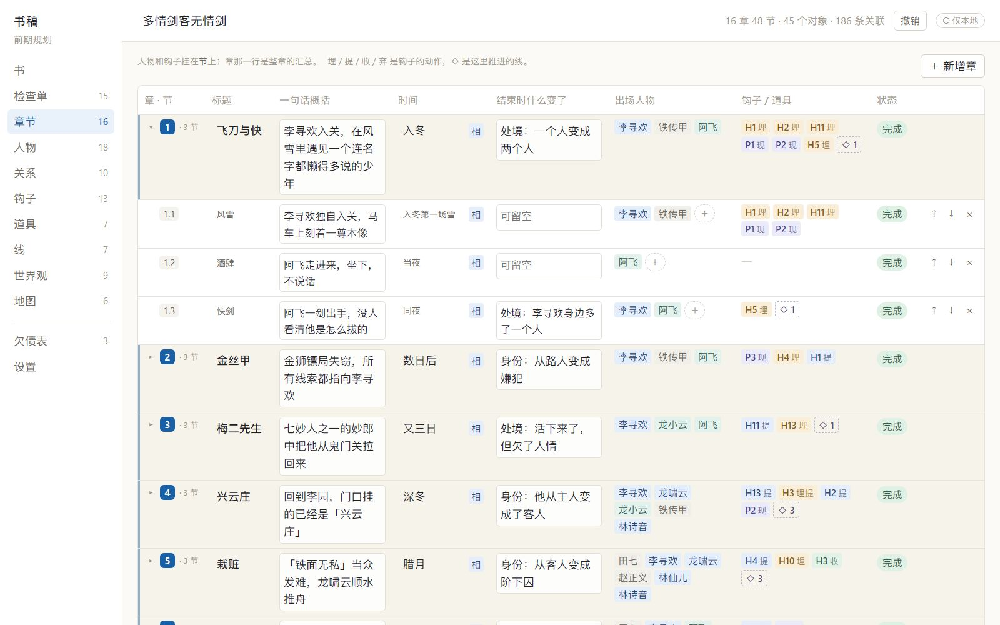
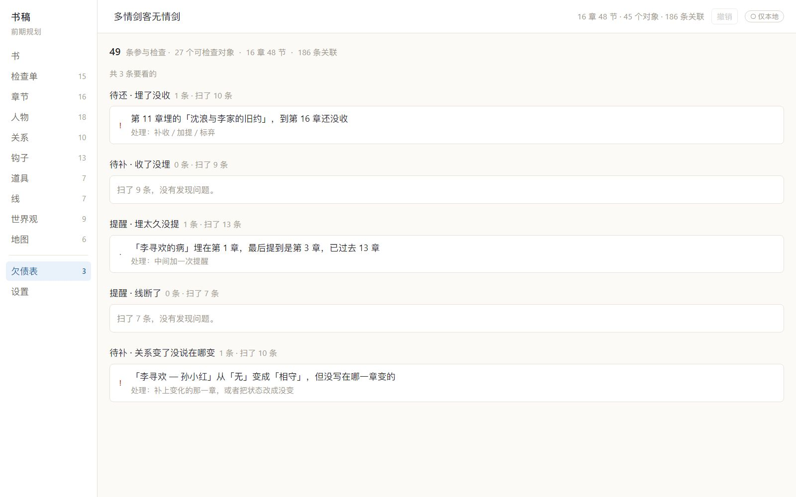
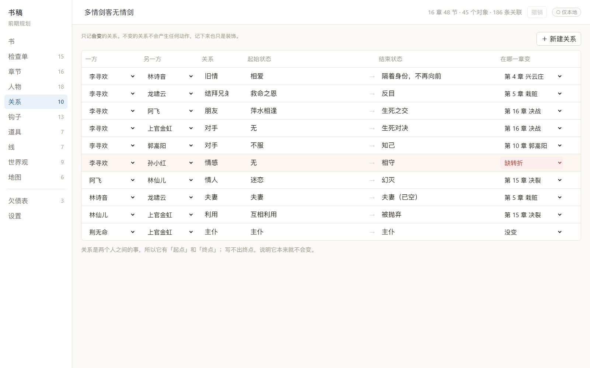

# 书稿 · 一个不碰正文的小说前期规划工具

> 写书之前，把所有该想清楚的事想清楚，并保证它们之间不打架。

**在线体验**：https://shugao-novel-planner.app.workbuddy.host/?sharecode=WLNUQKJ3M5
（打开就是一份填好的示例《多情剑客无情剑》，可以直接点；想看空白去设置里清空）

**使用说明**：站内左侧栏最下方「使用说明 ↗」，或直接打开
https://shugao-novel-planner.app.workbuddy.host/使用说明.html?sharecode=WLNUQKJ3M5



---

## 它解决什么问题

写长篇最常见的死法，不是文笔差，也不是没灵感，是**写着写着散了**：

- 人物性格前后不一
- 埋的伏笔忘了收
- 某条线断了三万字
- 结局跟开头不是同一本书

这些问题有个共同点：**都不是写的时候发现的，是写完之后发现的。** 等你发现，已经改不动了。

所以这个工具不写正文，也不读正文。它只做三件事：

1. 把该问的问题问出来（24 条，分四个阶段）
2. 把伏笔的账记下来（埋 / 提 / 收 / 弃）
3. 把对不上的地方指出来（五类检查）

---

## 核心判断：只记账，不判断

这是整个产品最重要的一条设计决定。

大多数写作工具试图「理解」你的内容——用 AI 读稿子、自动抽取人物、判断情节合不合理。这条路的问题是：**AI 一定会误报，而误报比漏报危险得多。**

误报会让作者改掉本来正确的东西，而且它会伪装成「洞察」，越像洞察越难被发现——作者会替它找理由。

所以这里的做法是反过来的：

> **判断权在作者手上，软件只做配对。**

作者在第 2 章打一个「埋」的标签，第 16 章打一个「收」的标签，软件就知道这条线闭合了。它不需要理解那 2000 字里写了什么，因此**从原理上不可能误报**。



五类检查，全部只数关系、不评内容：

| 检查 | 查什么 |
|---|---|
| C1 埋了没收 | 有「埋」、没有「收」也没有「弃」 |
| C2 收了没埋 | 有「收」，但全书没埋过 |
| C3 埋太久没提 | 埋下之后超过 N 章没再提到 |
| C4 线断了 | 某条线超过 N 章没有推进 |
| C5 关系变了没说在哪变 | 关系状态变了，但没标变化章；或标了，但那章两人都没出场 |

---

## 三个反常识的设计

### 一、不是打勾，是五种状态


「这个问题我想清楚了」——勾上。写到一半发现根本没想清楚。这是常态，不是例外。

所以问题是五态的：**未答 / 有想法 / 待验证 / 已确认 / 不适用**。

其中「待验证」是关键：你想过，但还没写到时候。它比「已确认」诚实，因为它承认自己还没被检验过。

不做百分比进度条，只给精确计数。因为「80% 完成」会制造虚假的完成感，而虚假的完成感会让作者更早崩盘。

### 二、软钩子不进欠债表

硬钩子必须收：丢了的那支发钗到谁手里了、密信写了什么。
软钩子可以不收：街角那个总在擦刀的人、算命瞎子念叨的一句没头没尾的话。

如果所有细节都必须有用，这本书会工整，但假。真实的世界里有大量不回收的东西。

### 三、24 条问题，单个阶段不超过 8 条

不是八十条。分阶段不是为了流程好看，而是因为在错误的时机问对的问题，答出来的答案也是假的——第一卷还没写就问「副线在哪一章和主线交汇」，你只能编。

这一条写进了单元测试：`单个阶段不超过 8 条`。题库最容易的烂法就是越加越多，最后变成一个没人填的问卷。

---

## 用它跑一本真书

为了验证，我把《多情剑客无情剑》的完整结构填了进去：16 章 / 48 节 / 18 个人物 / 13 个钩子 / 10 条关系 / 186 条关联。

跑出来的结果比预想有意思：

- **13 个钩子里 10 个硬钩子，9 个都收了。** 古龙收钩子比大多数作者干净。
- 报出 1 条真欠债：「沈浪与李家的旧约」第 11 章埋，到第 16 章没收。原著确实没交代。
- 报出 1 条间隔：「李寻欢的病」埋第 1 章，最后提到第 3 章，中间隔了 13 章。
- 关系检查报出：「李寻欢 — 孙小红」从「无」变成「相守」，但没写在哪一章变的——原著里确实没有一场「他们在一起」的戏。



**这个工具不是让你写得更对，是让你提前看见这本书的形状。** 形状有问题，你在第一万字就知道，而不是在第三十万字。

---

## 技术实现

- **React + TypeScript + Vite**，没有 UI 库，没有状态管理库
- **数据模型只有三样**：实体（人物/钩子/道具/线）、关联（实体 × 章节 × 动作）、章序轴。五类检查全是对同一张表的查询——做成四张独立表就得写 UNION，以后加「地点」「组织」还要改结构
- **51 个单元测试**，覆盖检查逻辑的边界、例外、以及「0 数据 ≠ 0 问题」的约束
- **撤销栈**：`useReducer` 外包一层历史栈，同一字段 700ms 内的连续输入合并成一步（否则打一句话要按二十次 Ctrl+Z）
- **自动快照**：每 10 分钟一版，最多 6 版，快照剥掉地图底图（base64 一张几百 KB，会吃光 5MB 配额）
- **单文件构建**：`vite-plugin-singlefile` 打成 260KB 的 HTML，双击即用，不需安装、不联网、无账号

### 中文写作的细节

做中文写作工具，有些坑踩了就废：

- 输入法必须判 `compositionstart/end`，不然选字时按回车会把拼音直接提交
- 字号基准 18px 起——2K 屏 100% 缩放下约 109 PPI，15px 看起来只有 13px
- 表格里中文换行、别名统一（「陆爷」和「陆小凤」会被当成两个人）

---

## 怎么跑起来

**方式一（推荐给评委）**：双击 `书稿.html`，用 Chrome 或 Edge 打开。不需要环境。

**方式二（开发）**：

```bash
cd app
npm install
npm run dev      # http://localhost:5173
npm run test     # 51 个单元测试
npm run build    # 生产构建
npm run build:single  # 单文件 HTML
```

---

## 当前状态与局限

这是一个**功能完整但尚未经过大规模真实用户验证**的原型。

- 数据存在浏览器 localStorage，清缓存会丢。正式版需要接 SQLite 单文件
- 关系图、时间轴泳道图还没做——刻意压后，因为它们是「展示品」，日常用不上
- 还没有任何 AI 能力。这是设计选择，不是能力缺失（理由见上文）

## 示例数据说明

内置示例使用《多情剑客无情剑》的情节结构做演示，属于评论与研究性质的引用；人物与情节版权归古龙著作权方所有。示例中的「性格」「底线」等字段是对文本的判断，不是原文摘录。

---

## 关于作者

一个平面设计师给自己做的工具。因为市面上所有写作软件都在解决「怎么写得舒服」，没有人在解决「怎么不写崩」。
